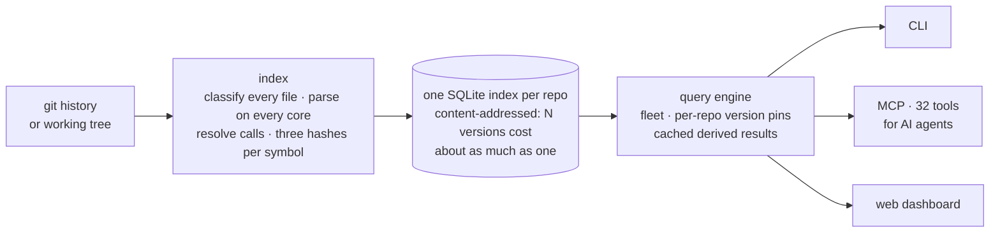

<h1 align="center">reponite</h1>

<p align="center">
  <b>Code intelligence across branches, tags and repositories — for people and AI agents.</b>
</p>

<p align="center">
  <a href="https://github.com/vishwak02/reponite/actions/workflows/go.yml"></a>
  <a href="https://github.com/vishwak02/reponite/releases"></a>
  <a href="go.mod"></a>
  <a href="LICENSE"></a>
</p>

<p align="center">
  <a href="docs/INSTALL.md">Install</a> ·
  <a href="#quickstart">Quickstart</a> ·
  <a href="docs/USER_GUIDE.md">User guide</a> ·
  <a href="#ai-agents">AI agents</a> ·
  <a href="docs/USER_GUIDE.md#command-reference">Commands</a>
</p>

---

reponite is a single binary that indexes your repositories — at as many branches, tags and
commits as you like — and answers questions about the code: what it does, who calls it, how
it changed between two versions, and what a change will break, across repository
boundaries. It runs locally, reads git history without checking anything out, and gives
every answer with the evidence it rests on and a confidence score.

You use it from the command line, from an AI agent through MCP, or from a local web
dashboard.

## What it answers

| You want to know | Command |
|---|---|
| What is in this codebase, and where does it start? | `map`, `explain` |
| Where is something, and which function is each match in? | `grep`, `search`, `semsearch` |
| Who calls this, and what does it call? | `usages`, `context`, `impls` |
| What happens when this function, route, command or topic runs? | `trace` |
| Did this symbol change between two versions — its signature, or only its behavior? | `compat`, `diff` |
| Which change actually caused a behavior difference? | `rootcause`, `rootcause-trace` |
| What breaks if I change or save this? | `blast-radius`, `verify-edit`, `ximpact`, `ci-check` |
| Where does this error or log line come from, and who handles it? | `errors`, `logsite` |
| Which tests cover this, and how do I run only those? | `tests` |
| Why is this code like this — which commits and PRs? | `why` |
| Which UI action calls which API, and which server route serves it? | `ui`, `routes` |
| What does the backend store, and what configuration does it read? | `models`, `config` |
| In a ROS system, who publishes and who subscribes to a topic? | `topics` |
| What refers to this file or class through configuration, includes or ids? | `links` |
| Was every file read, and why was anything skipped? | `coverage` |
| Everything needed to edit one symbol, in one answer | `brief`, `investigate` |

Languages: parsed — Go, Python, JavaScript, TypeScript (JSX/TSX), Vue, Svelte, Java, C, C++,
Rust, shell and Robot Framework; read heuristically — Kotlin, Swift, C#, Ruby, PHP, Lua, Scala,
Dart, Groovy, Perl, R, Elixir, Julia and Zig. ROS interface and launch files, and every other
text file (YAML, JSON, Markdown, XML, CSV, templates, CI workflows, …) are stored and searchable,
with their structure — keys, headings, elements — as sections. Details are in the
[user guide](docs/USER_GUIDE.md#languages-and-file-types).

## How it works



Each symbol gets three hashes — its text, its signature, and its behavior (a Merkle hash
over everything it calls) — which is how a change is classified as compatible, a signature
change, or a behavior change. The full design, with diagrams of the indexing pipeline, the
storage schema and the query path, is in [docs/architecture.md](docs/architecture.md).

## Install

```sh
curl -fsSL https://raw.githubusercontent.com/vishwak02/reponite/main/install.sh | sh
```

Or build from source (Go 1.22+ and a C compiler):

```sh
git clone https://github.com/vishwak02/reponite && cd reponite && make cli   # → bin/reponite
```

[docs/INSTALL.md](docs/INSTALL.md) covers requirements, build options, agent setup, where
data is kept, upgrading and troubleshooting.

## Quickstart

```sh
cd ~/src/my-project
reponite index .                    # index the working tree (ref HEAD)
reponite index . --git v1.0.0       # index a tag, straight from git — no checkout
reponite map --format text          # orientation: entry points, modules, dependencies
reponite explain Charge             # one symbol: doc, body, callers, callees, tests
reponite compat Charge              # did it change since v1.0.0? signature or behavior?
reponite rootcause Charge v1.0.0 HEAD   # which function's change caused it
```

`compat` returns one verdict per indexed ref:

| Verdict | Meaning |
|---|---|
| `compatible` | same signature and same behavior |
| `shape_changed` | the signature changed — callers must change too |
| `behavior_changed` | same signature, but something it calls changed underneath |
| `absent` | the symbol does not exist at that ref |

Every command prints JSON (most also take `--format text`) and ends with a `_meta` block
saying which ref was read and how complete the answer is.

## AI agents

```sh
reponite setup ~/src/my-project                        # Claude Desktop
reponite setup ~/src/my-project --client claude-code   # or cursor, windsurf
```

The agent then has 32 tools (`reponite_map`, `reponite_explain`, `reponite_trace`,
`reponite_usages`, `reponite_compat`, `reponite_verify_edit` and more), each answer
budgeted in tokens and labeled with its confidence. `reponite guide` prints which tool
answers which question. The full list is in the
[user guide](docs/USER_GUIDE.md#ai-agents-mcp).

## Many repositories

Every indexed repository joins a local registry, so cross-repo questions — who in another
repository calls this, which client calls this route, which node subscribes to this topic —
work from any directory. `REPONITE_REFS=repo=ref,…` pins each repository to the version a
deployed system runs. See [Working with many repos](docs/USER_GUIDE.md#working-with-many-repos).

## Web dashboard

```sh
reponite serve      # http://127.0.0.1:8899 — every registered repository
```

Overview, Explore, Diff, Impact, Topics, Usages and Verify views, all deep-linkable, with no
external assets.

## Documentation

| Document | Contents |
|---|---|
| [docs/INSTALL.md](docs/INSTALL.md) | Installation, agent setup, data locations, upgrading, troubleshooting |
| [docs/USER_GUIDE.md](docs/USER_GUIDE.md) | Concepts, every command with examples, configuration, FAQ |
| [docs/architecture.md](docs/architecture.md) | How it is built |
| [docs/adr/](docs/adr/) | Architecture decision records |
| [CONTRIBUTING.md](CONTRIBUTING.md) | Building, testing and contributing |
| [CHANGELOG.md](CHANGELOG.md) | Changes by release |

## License

[Apache-2.0](LICENSE) © reponite contributors
