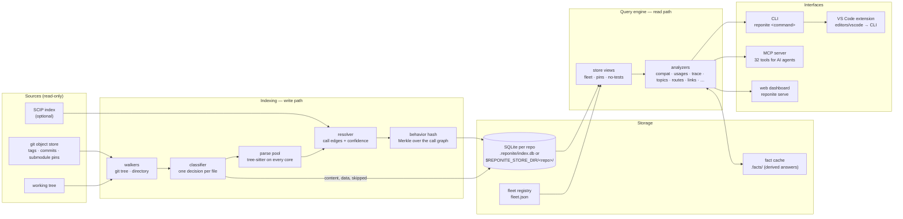
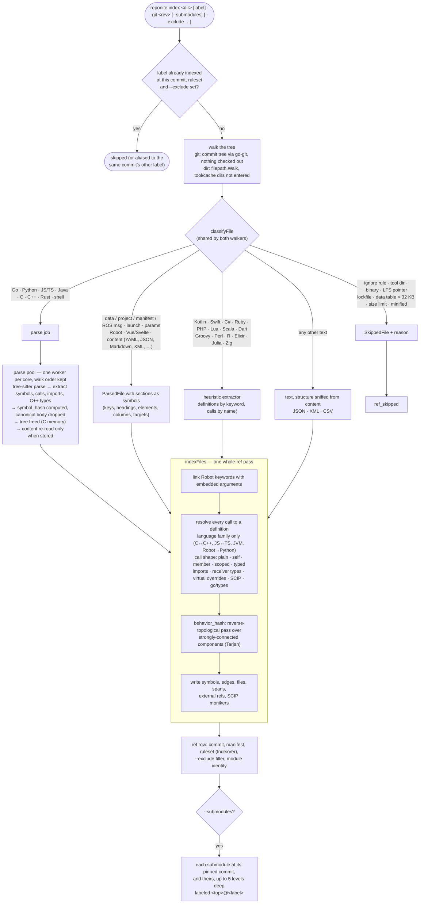
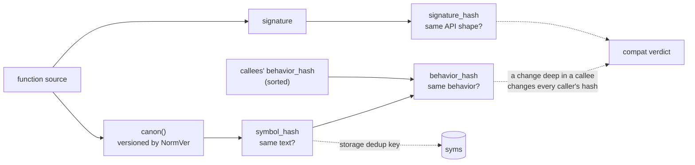
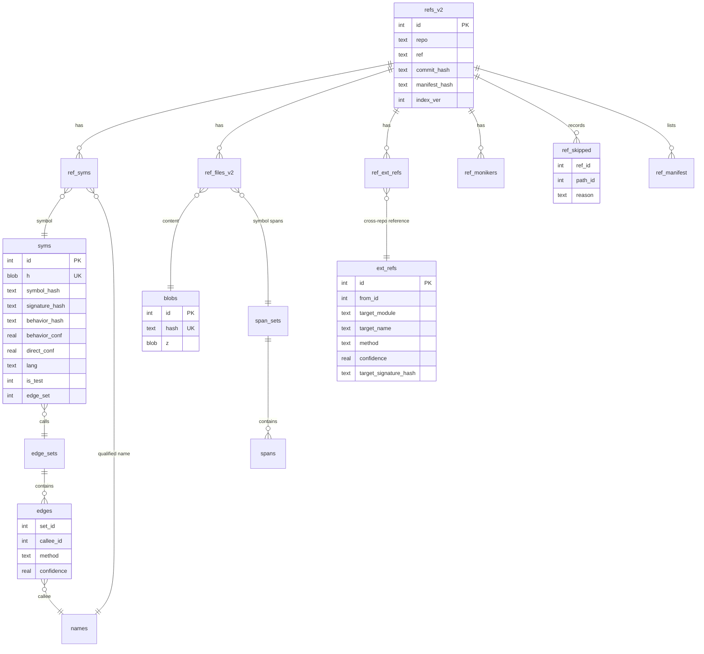
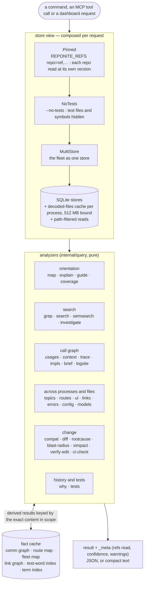
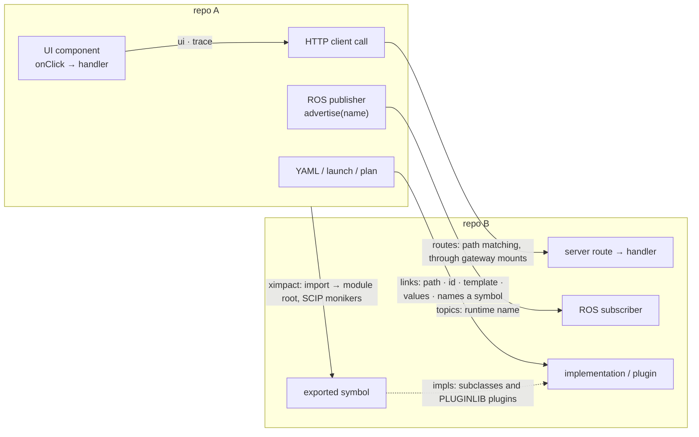
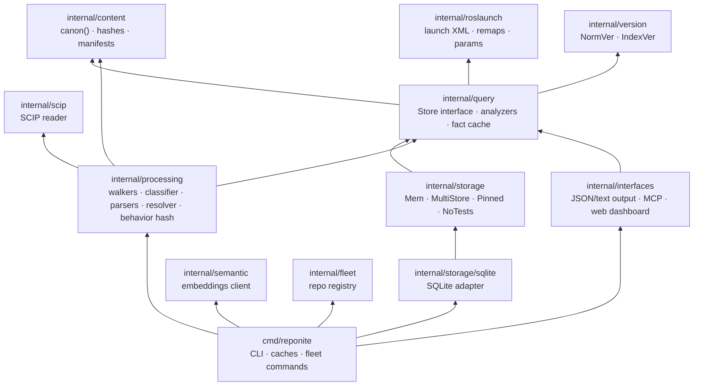

# reponite — Architecture

How reponite is built: what happens when a repository is indexed, how the index is
stored, and how a question is answered. Decisions and their rationale are in
[the ADRs](adr/); the agent-facing feature designs are in
[agent-features.md](agent-features.md). Diagrams are Mermaid and render on GitHub.

## 1. The system at a glance

reponite reads source code once — from git's object store or a working tree — and
keeps what it learned in one SQLite index per repository. Every question is then
answered from those indexes, across any number of repositories and versions,
without checking anything out.

## 2. Design principles

- **Never lie.** Every call edge carries how it was resolved and a confidence; every
  answer carries a `_meta` block; a verdict inherits the lowest confidence of its
  evidence. A name that cannot be resolved is listed as unresolved, not guessed.
  An empty answer can be checked against what was read (`coverage`).
- **Storage proportional to unique content.** Content-addressing (git's model): ten
  indexed tags cost little more than one.
- **Pure core, thin adapters.** Correctness-critical logic is standard-library Go and
  unit-tested anywhere; SQLite, tree-sitter and the MCP SDK live in build-tagged
  adapters behind interfaces ([ADR-018](adr/ADR-018-pure-core-thin-adapters.md)).
- **Nothing silently dropped.** Every tracked file is parsed, stored, or skipped with
  a recorded reason.
- **Compute once.** Expensive derived results are cached against the exact content
  they were derived from, so a repeated question is answered from disk.

## 3. Indexing — the write path

**Resolution confidence.** Each call edge records its method; the method decides the
confidence and is part of the edge's identity:

| Method | Confidence | Basis |
|---|:---:|---|
| `go-types` | 1.0 | proven by the Go type checker |
| `scip-resolved` | 0.95 | a SCIP moniker two indexers agree on |
| `name-resolved` | 0.9 | exactly one definition in scope |
| `receiver-typed` | 0.85 | a C++ member call whose receiver's declared type is known |
| `import-resolved` | 0.75 | the caller's import binding resolves to the target's module root |
| member call | 0.7 | `obj.f()` with the receiver's type unknown |
| `virtual-override`, `unresolved-external` | 0.6 | a base-class call reaching overrides; a name defined outside the repo |
| `ambiguous` | 0.5 | several definitions, no way to choose |

**Scale.** Parse trees live in C memory the Go collector cannot see, so each is freed
the moment its file is extracted; symbol hashes are computed at parse time and the
canonical body dropped; source text is re-read when it is stored instead of being held
for the whole ref; collection runs at 1.5× the live heap during indexing. A full Linux
kernel tree (67,000 indexed files) indexes in about three minutes at about 5 GB peak.

## 4. The three-hash identity model

Three different "is this the same?" questions, three hashes over a canonical form
(`canon()`: formatting and comments removed; identifiers, literals, operators and
structure kept — when unsure, keep the difference):

`compat` compares the three hashes of one symbol at two refs:
`compatible` (same shape, same behavior), `behavior_changed` (its body or something it
calls changed), `shape_changed` (its signature changed), `absent` / `added`.
`rootcause` then walks the call graph to the mutation frontier — the symbols whose own
text changed — versus those merely carried along by a callee.

## 5. Storage

One SQLite database per repository, holding every indexed ref of it. A ref owns no
content: it points at deduplicated rows. Symbols, edge sets, span sets and file blobs
(zlib-compressed) are stored once and shared by every ref that contains them.

`store_meta` holds the on-disk format version and, per ref, the `--exclude` filter it
was indexed with; `repo_modules` the repository's module identity (go.mod module,
package.json name, …) used to resolve cross-repo imports. Each ref is stamped with the
ruleset it was indexed under (`IndexVer`, currently 12); answers that compare refs
indexed under different rulesets say so.

The **fleet registry** (`fleet.json`) lists every indexed repository and where its
index lives; commands and the MCP server mount the whole fleet by default.

## 6. Answering a question — the read path

**Caching.** A fleet-wide result (the ROS communication graph, the HTTP route map, the
fleet map, the reference graph, each repo's test-word index) is a pure function of the
indexed content, so it is cached on disk under a key made of every in-scope repo's
ref, commit, manifest hash and ruleset, the call's arguments, the binary's identity and
the test view. A re-index, a different pin or a rebuilt binary is a different key —
nothing stale is served. Repeated fleet `map` on 40 repositories: 32 s the first time,
0.1 s after.

## 7. Crossing boundaries

The call graph stops at a process, a file format or a repository. These analyzers
recover the edges it cannot see:

| Edge | How it is resolved |
|---|---|
| UI → API → server | `ui` finds pages, component trees and handlers; `routes` matches each client URL to a route by path segments, through reverse-proxy gateway mounts (Caddy JSON); `trace` chains them with the call graph and side effects |
| ROS publisher → subscriber | `topics` pairs endpoints on the **runtime** name: launch-file remaps, names read from parameters (launch `<param>`/`<rosparam>`, YAML), names a library takes from its caller (arguments and `NodeHandle` namespaces followed back through call sites), rviz displays and tools, launch-declared bindings |
| repo → repo | `ximpact` / `blast-radius`: tier 0 SCIP moniker (0.95), tier 1 import resolved to a module root (0.75), tier 2 bare name (0.6); each caller records the signature it expected |
| file → file, config → code | `links`: strings resolving to tracked files (relative, root, ROS package, Ansible role, unique suffix or name), ids defined in one structured file and used in another, template includes, Helm `.Values` keys, protobuf rpcs to implementations, OpenAPI paths to routes, configuration values naming a symbol |
| base → implementation | `impls`: class hierarchies and `PLUGINLIB_EXPORT_CLASS` across the fleet |
| error text → producer → handler | `errors`: raise/throw/error values/HTTP responses matched by message template or fragment, catalogues defined as data (JSON, YAML, gettext) |

## 8. Code layout

| Package | What it holds | Build tag |
|---|---|---|
| `internal/content` | `canon()`, the three hashes, manifests and dedup | — |
| `internal/processing` | classifier, content sections, heuristic extractor, Robot, ROS files, resolver, behavior hash, module detection | — |
| `internal/processing` (`*_ts.go`, `index_git.go`) | tree-sitter parsing, `IndexDir`, `IndexGitRef`, parse pool | `treesitter` |
| `internal/query` | the `Store` interface and every analyzer, fact cache, coverage, links | — |
| `internal/roslaunch` | launch-file parsing, remap and parameter resolution | — |
| `internal/storage` | in-memory store and the fleet/pin/no-test views | — |
| `internal/storage/sqlite` | the SQLite store, decoded-files cache, skips and filters | `sqlite` |
| `internal/scip` | SCIP index reader (a protobuf subset) | — |
| `internal/fleet` | the persistent repo registry | — |
| `internal/semantic` | optional embeddings endpoint for semantic search | `neural` |
| `internal/interfaces` | JSON and compact-text renderings, MCP tools, the web server and its embedded app (`webui/dist`, built from `web/`) | `mcp` for the server |
| `cmd/reponite` | the CLI | `sqlite && treesitter` for index-backed commands |

## 9. Build tiers and verification

| Job | Build | Verifies |
|-----|-------|----------|
| `core` | default | the pure packages, and the `neural` adapter (standard library only) |
| `sqlite` | `-tags sqlite` | the SQLite store, its migrations and caches |
| `treesitter` | `-tags treesitter` | parsing, extraction, the classifier, both walkers |
| `mcp` | `-tags "sqlite mcp"` | the MCP server builds against the SDK |
| `e2e` | `-tags "sqlite treesitter"` | index real repositories across refs and assert answers |

`tools/battery.py` runs every command over a directory of real repositories and
grades each call (crash, error, slow, ok); two runs can be compared.

## 10. Known limits

Each is stated in the output rather than hidden:

- Everything is static. A name built at runtime from a value no file holds (a server
  response, an environment variable set elsewhere) cannot be followed; it is listed as
  unresolved.
- Heuristic languages find definitions by keyword and calls written as `name(`; a call
  without parentheses or a definition in an unusual form is missed.
- `<include>` directives in ROS launch files are not expanded; a remap whose target
  keeps an unexpanded substitution is reported, not applied.
- Cross-repo **behavior** propagation is out of scope: impact answers who calls, not
  whether it still behaves the same over there.
- SCIP's relationship graph (implementations, overrides) is not consumed; `impls`
  reads class hierarchies from source.
- Indexing memory grows with the number of symbols: about 5 GB at the peak for a full
  Linux kernel tree.
